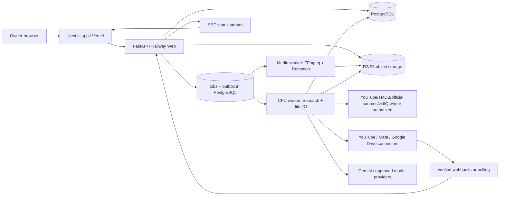

# 02 — REFERENCE ARCHITECTURE AND SYSTEM WORKFLOWS

## 1. Topology



**Logical architecture:** one deployable Python application for API/domain logic; two distinct worker process roles running same codebase, and a Next.js web application. Dedicated media renderer process may use a separate container size/region. No worker shares the API process memory or assumes a single process.

**Dependency direction:** `web → api/domain services → persistence/adapters`, `workers → domain services`; provider adapters cannot directly mutate campaigns except through documented domain services. No SQL/database writes from browser or image-rendering logic.

## 2. Locked technology choices / versioning

- Python 3.13 (verify current compatible point release at bootstrap); FastAPI, Pydantic v2, SQLAlchemy 2 + Alembic, `httpx` with strict timeouts, Postgres via psycopg 3. `ruff`, `mypy`, `pytest`, `hypothesis` for backend.
- TypeScript, Next.js App Router, React; `zod`, TanStack Query, `vitest`, Playwright. Use a signed owner session via HttpOnly cookie; forms use CSRF protections.
- Rendering: pinned FFmpeg build, Node LTS, Remotion pinned tested version; run native media jobs in sandboxed worker with per-job isolated temp directory, fixed resource limits, timeouts, no network egress in render subprocess.
- Postgres as durable truth; transactionally claimed jobs via `FOR UPDATE SKIP LOCKED`. Use outbox table as event bridge. If load later requires a dedicated broker, migrate the queue behind an interface; do not build Redis dependency by default.
- R2/S3-compatible storage for immutable objects; signed per-object links with short TTL; Google Drive exports via resumable upload and stored Drive file IDs. All files represented by DB asset/export records, not arbitrary OS paths.
- External integrations via `connectors/` with a `CapabilityMatrix` negotiated per account. No speculative API features.
- OpenTelemetry tracing where supported + structured JSON logs, error reporting, metrics and alerts. No provider secrets in logs.
- Infrastructure via IaC (Terraform or Pulumi chosen in ADR and pinned), reproducible staging. No manual production database edits.
- Store repository-local `requirements.lock`/`uv.lock` and `pnpm-lock.yaml`; pin build images by SHA/digest in production. Apply dependency update bots only through CI.

## 3. Independent new repository layout

```text
screen-central-os/
  README.md
  AGENTS.md
  docs/architecture/        # this blueprint, ADRs, diagrams, API policy matrix
  apps/web/                 # Next.js authenticated private UI
    app/(private)/          # ten workspaces
    components/            # design system, media player, timeline, source viewer
    lib/api/               # OpenAPI-generated typed client
  services/api/             # FastAPI, owner auth, REST + SSE
    scos/domain/           # opportunities, claims, campaigns, assets, QA, posts, feedback
    scos/repositories/     # SQLAlchemy DB adapters + transaction boundary
    scos/connectors/       # youtube/meta/google/vidiq/tmdb/llm/tts/stock
    scos/workers/          # durable job execution, leases, outbox, cost reservations
    scos/security/         # sessions, CSRF, OAuth, access checks, secrets
    migrations/            # Alembic forward/rollback migrations
  services/media/           # FFmpeg/Remotion templates and renderer CLI
    templates/             # long, vertical, 1:1 carousel, static graphic
    tests/golden/          # pixel, audio, media metadata, reproducible clips
  packages/contracts/      # OpenAPI, Pydantic/TS generated types, event JSON schemas
  fixtures/synthetic/      # ORIGINAL public-domain/owner-created test media only
  infra/                   # separate dev/staging/prod IaC; env var templates
  scripts/                 # bootstrap, local seed, restore drill, cleanup, load test
  tests/e2e/               # browser tests and fault-injection scenarios
  .github/workflows/       # PR tests, staging deploy, production approval gates
  Makefile
  docker-compose.yml
```

**Boot:** `docker compose up -d postgres s3mock`; `make migrate`; `make dev`; `make test`; `make test-e2e`; `make smoke-media`; `make down`. Render service must have a deterministic test profile and synthetic media fixtures.

## 4. Environment and network policy

| Environment | Database/storage | Provider credentials | Publishing | Default spend |
|---|---|---|---|---|
| local | ephemeral pg + local S3 emulator (MinIO) | Mock by default; optionally explicit test credentials | Mock only | $0 external |
| CI | ephemeral postgres + fixtures + S3 emulator | No real keys | Mock only | $0 |
| staging | isolated pg / isolated R2 bucket / isolated Drive test folder | Sandbox or read-only keys where supported | Mock adapters; NEVER production accounts | $0 unless one-time approved test |
| production | distinct pg / R2 bucket / Drive archive | Account-scoped production grants | Disabled until owner enables specific verified account | Owner-defined cap; initially $0 before enablement |

Hostnames, OAuth callback URIs, domain cookies, tokens and env secret names are unique to SCOS. Never import Scrapper secrets into these environments. Cross-environment database/network access prohibited by default. Staging cannot be promoted with real posting credentials by mistake because a policy enforces `ENVIRONMENT == production` and per-account `publish_enabled`.

## 5. Bounded contexts

1. `identity`: owner, sessions, credentials, audit and consent.
2. `discovery`: monitored topics, entity aliases, source signals and ideas.
3. `research`: external source snapshots, claims, evidence adjudication and brief readiness.
4. `editorial`: briefs, campaigns, revisions, scripts, creativity decisions and experiments.
5. `assets`: media object identity, licenses, manifests, derived frames, indexing and permitted uses.
6. `production`: treatment variants, render jobs, preview exports, QA, final immutable approval.
7. `distribution`: social account capability, schedule, platform package, attempt and receipt.
8. `community`: imported thread, classification, reply draft, owner approval and actual reply receipt.
9. `analytics`: normalized immutable time-window metrics, attribution, diagnosis and learning.
10. `operations`: jobs, leases, errors, costs, backups, dead-letter queue, system alerts.

No context can treat freeform JSON from another context as trusted proof. Cross-context write actions go through typed services and state transitions.

## 6. State machines and transition requirements

### 6.1 Opportunity
`new → triaged → research_pending → researching → researched → accepted | rejected | deferred`.
- `rejected` is preserved in a permanent dedup/watch ledger; `deferred` may be retried after a new signal or manual override.
- Only `accepted` with approved research version can instantiate a production Campaign.

### 6.2 Claim
`proposed → evidence_pending → supported | contradicted | uncertain | rejected`.
- `supported` requires a specific accepted primary/evidence span, adequate scope and fresh source for time-sensitive facts; `uncertain` is usable only when narration clearly discloses uncertainty and owner approves.
- New material contradictions or source revisions invalidate supported status pending review.

### 6.3 Campaign
`draft → brief_review → brief_approved → producing → qa_pending → qa_failed | ready_for_approval → approved → published | archived`.
- A Campaign may contain different variants at distinct states; Campaign-level `published` means at least one confirmed publication, not all. Per-variant/per-platform state is authoritative.
- `brief_approved` requires approved claim bundle and rights planning. Revisions to dependencies create new immutable version and invalidate affected approvals only.

### 6.4 Export
`requested → queued → running → rendered → qa_failed | qa_passed → approved → available | revoked`.
- QA pass requires technical verification; `approved` further requires editorial and rights review by owner. An export object is immutable once `rendered`; subsequent revision creates a new row/hash.
- `revoked` prevents new publishing but retains audit history. Already published items are flagged as needing review or corrective action.

### 6.5 PublicationAttempt (per platform account, not per campaign)
`draft → scheduled → claimed → submitting → provider_processing → confirmed | rejected | unknown | cancelled`.
- `unknown` includes accepted-or-not-known responses after crash, timeout, or provider inconsistency. NEVER automatically submit again while the same content/account/platform has an unresolved attempt.
- `rejected` is retriable only after classifying failure and verifying provider did not create media; retry uses a newly recorded attempt with parent reference and original uniqueness guard.
- `confirmed` requires verified provider post ID, account and timestamp, not 200 OK alone.
- `cancelled` applies only before irreversible provider submission; post-submission cancellation is provider-specific and must be explicitly authorized.

### 6.6 Reply
`draft → review → approved → sending → confirmed | unknown | rejected`. Owner approval binds exact reply text hash, external comment ID and account ID. Any edit invalidates approval.

### 6.7 Job
`queued → leased → running → succeeded | retry_wait | blocked | failed | cancelled | dead_letter`.
- Start in `queued` only after durable input snapshot exists; `leased` = DB claim; `running` = worker has heartbeat.
- On worker expiry, recover only idempotent internal operations. For side-effecting operations (`publish`, Drive external file create), first reconcile external status; unresolved goes `blocked/unknown`.
- Unrecognized exceptions never count as success; failures must be recorded with sanitized last error, retry count and trace.

## 7. Durable worker algorithm (normative)

1. In a transaction select one available job with `FOR UPDATE SKIP LOCKED`, ordered by priority, not_after and created_at.
2. Enforce `max_attempts`, spend reservation, dependency completion and explicit environment policies.
3. Set `lease_owner`, increment `lease_epoch`, `lease_expires_at`, move to `leased`, commit.
4. Worker heartbeats every 15s; default lease 60s; after every external call checkpoint durable stage and receipt. Final values configurable by measured task duration.
5. Updates check current `lease_epoch`, preventing a stale worker from clobbering new owner.
6. Side effects use a persistent operation intent row with dedupe key and reconciliation steps before first call.
7. Succeeded job commits outputs, event-outbox entry and cost actuals atomically; outbox dispatched separately with unique dedupe key and listener idempotence.
8. Retry only safe errors with exponential backoff+jitter; `Retry-After` honored. Defaults 3 attempts for research/processing, 0 blind retries for external publishing with unknown outcome.
9. `cancel` is cooperative; immediate stop checks between model calls, before provider writes and during render process; never claim a cancelled provider upload was cancelled if outcome is unknown.
10. Dead letter after attempts exhausted with explicit owner action to inspect/retry after fixes.

Suggested dispatcher SQL predicate: `status IN ('queued','retry_wait') AND available_at <= now() AND (lease_expires_at IS NULL OR lease_expires_at < now())`. Index by `(status, available_at, priority)`.

## 8. Transaction boundaries and outbox

- All DB writes for a state transition and its `domain_event` commit in one transaction.
- The dispatcher claims undelivered events with `SKIP LOCKED`, tries handlers, marks delivery. Each handler maintains an inbox receipt `subscriber + event_id` unique constraint.
- Ordering guaranteed only per aggregate (`campaign_id`, `export_id`, `publication_id`), not globally. Event payload contains schema_version and aggregate_revision.
- Exactly-once delivery across arbitrary external APIs is **not promised**; use at-most-one unresolved attempt + reconciliation.
- Idempotency header `Idempotency-Key` on all write/create operations; store request hash and response, reject key reused with changed body; expire stored request tokens per policy after parent object is durable.

## 9. Integration adapters

```python
class ResearchProvider(Protocol):
    async def search(self, query: str, *, date_bounds, budget) -> list[SearchHit]: ...
    async def fetch(self, uri: str) -> SourceArtifact: ...

class ContentModel(Protocol):
    async def complete_structured(self, *, task, model_version, schema, inputs, budget) -> ModelResult: ...

class PublicationProvider(Protocol):
    async def capabilities(self, account_id) -> CapabilityMatrix: ...
    async def begin(self, intent_id, export_ref, package) -> ProviderReceipt: ...
    async def reconcile(self, receipt_or_intent) -> ProviderState: ...
    async def cancel_if_supported(self, receipt) -> ProviderState: ...

class AnalyticsProvider(Protocol):
    async def sync(self, account_id, since, until) -> Observations: ...

class ArchiveProvider(Protocol):
    async def ensure_folder(self, target, canonical_key) -> FolderRef: ...
    async def upload_resumable(self, intent, object_ref) -> ArchiveReceipt: ...
    async def verify(self, receipt, expected_hash, expected_bytes) -> Verification: ...
```

Typed provider exceptions: `AuthExpired`, `PermissionDenied`, `QuotaExceeded`, `RateLimited(retry_after)`, `TemporaryFailure`, `PermanentFailure`, `UnknownOutcome`, `PolicyBlocked`, `BudgetBlocked`. Do not collapse all to generic `Exception` and continue.

## 10. Media/render design

- Each `render_request` identifies immutable approved script revision, treatment, scene timeline, asset versions, license snapshot, voice/model version, brand kit hash, template revision and source SHA-256.
- A render worker copies only required approved objects to isolated temp location, verifies SHA-256, normalizes source media, generates audio/captions/assets, creates deterministic Remotion composition or FFmpeg filtergraph, renders, probes, runs QA, uploads immutable export and preview/contact sheet.
- Template renderer loads data only through schema validation; model-produced strings are never executable template expressions or shell fragments.
- Intermediate work cache is keyed by complete input hash; changed input invalidates dependent segments and QA.
- Render quality never inferred from `exit_code==0`. QC failures store diagnostics, do not overwrite earlier accepted exports.

## 11. Feature flags / kill switches

Mandatory initial flags (default off except purely local read features): `DISCOVERY_LIVE_READ`, `MODEL_PAID_CALLS`, `PROVIDER_YOUTUBE_PUBLISH`, `PROVIDER_INSTAGRAM_PUBLISH`, `PROVIDER_FACEBOOK_PUBLISH`, `DRIVE_ARCHIVE_ENABLED`, `AUTOMATED_RENDER`, `AUTOMATED_RESEARCH`, `AUTOMATED_PUBLISH`, `AI_COMMENT_DRAFTS`, `COMMENT_REPLY_ENABLED`, `THIRD_PARTY_MEDIA_INGEST`. Runtime policy rejects unsafe combinations (e.g. staging + publish true). All flag changes audited.

## 12. Platform boundaries and graceful degradation

Each connector persists capability fields: `can_read_public`, `can_read_private_analytics`, `can_upload_video`, `can_publish_reels`, `can_publish_images`, `can_publish_carousel`, `can_publish_text`, `can_list_comments`, `can_reply`, `can_delete`, `rate_limit_status`, `scopes`, `token_expiry`, `verified_at`, `last_error`. Unsupported is not assumed supported. UI shows “Requires authorization”, “Provider unavailable”, “Unsupported by official API”, or “Manual export available.”

## 13. Operational control flow

- Startup: verify DB migration level, storage health, owner/session config, production fail-closed flags, provider adapter versions, queue lease expiry, durable outbox. Never auto-publish just because service restarted.
- Shutdown: stop taking new jobs, heartbeat/complete safe running ones; mark uncertain side-effecting jobs for reconciliation; preserve temp files until verified or safely cleaned.
- Deployment: migrate-additive → deploy API → workers → UI → run smoke → flip feature flag; rollback UI/workers and migration-compatible schema as appropriate.
- Disaster recovery: restore DB into isolated environment, restore/decode object storage manifest, reconcile external posts (never repost automatically), run offline content and export verification, resume safe jobs.
